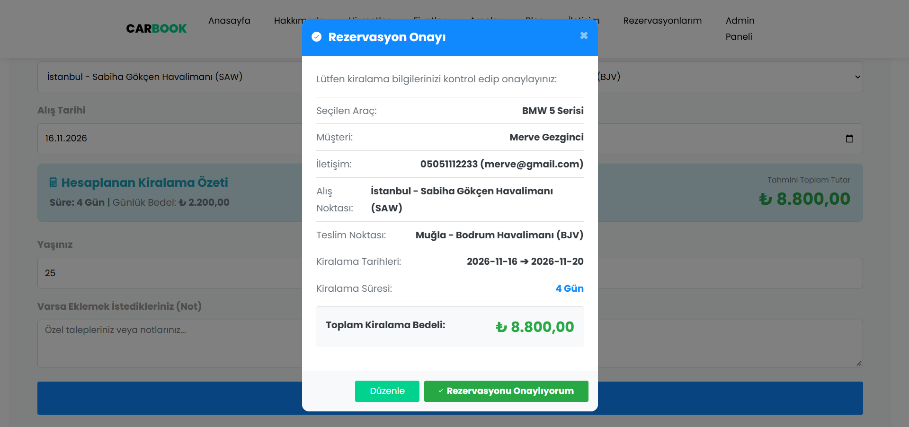
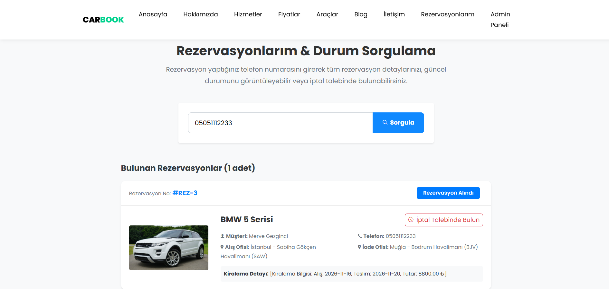
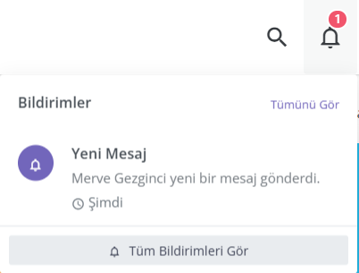
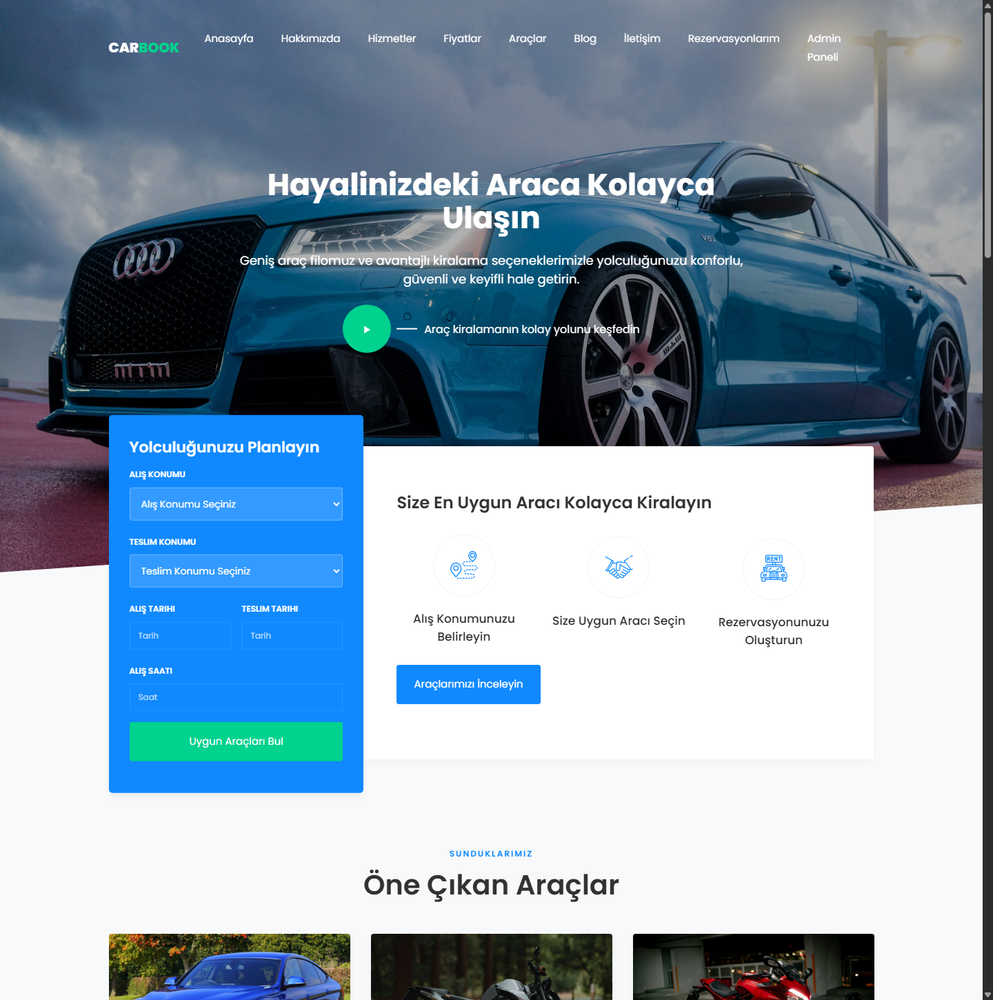
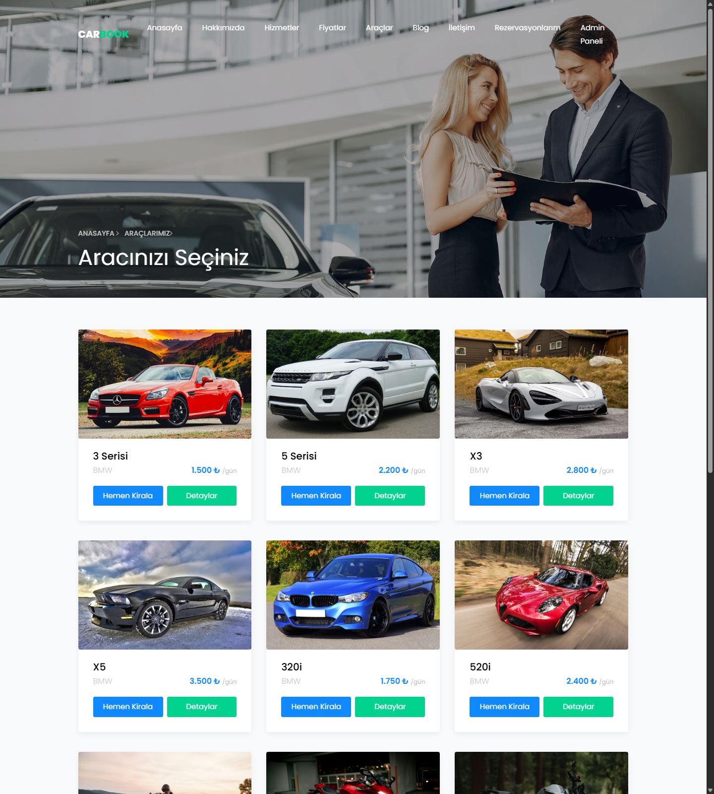
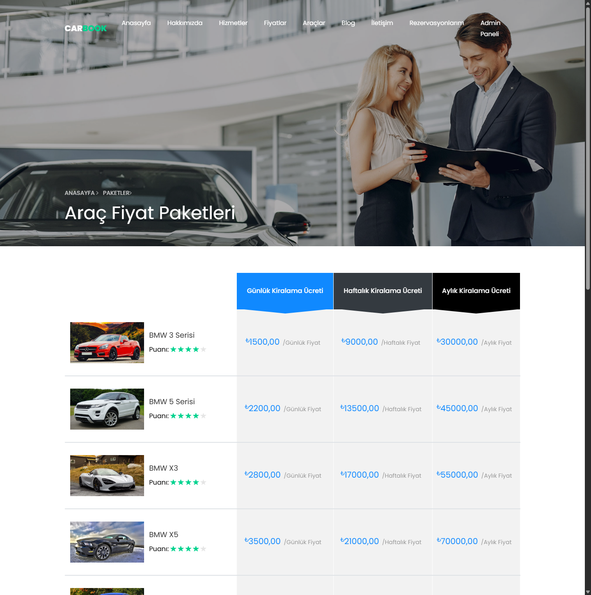
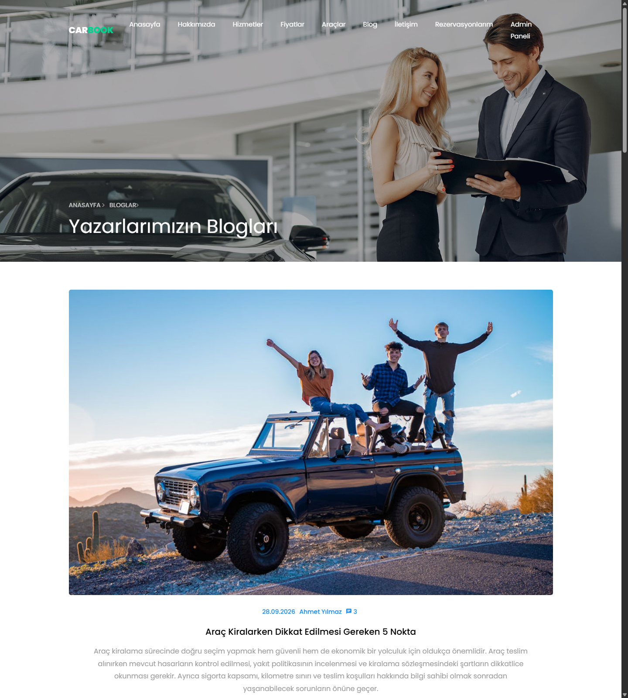
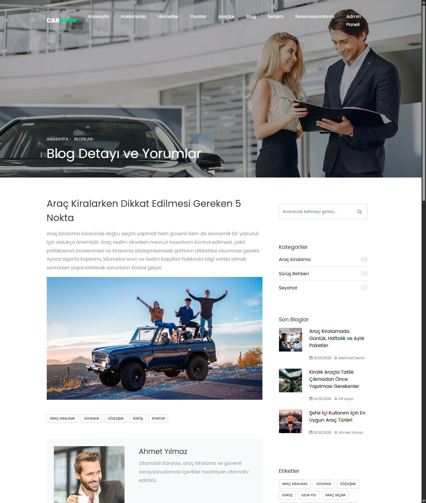
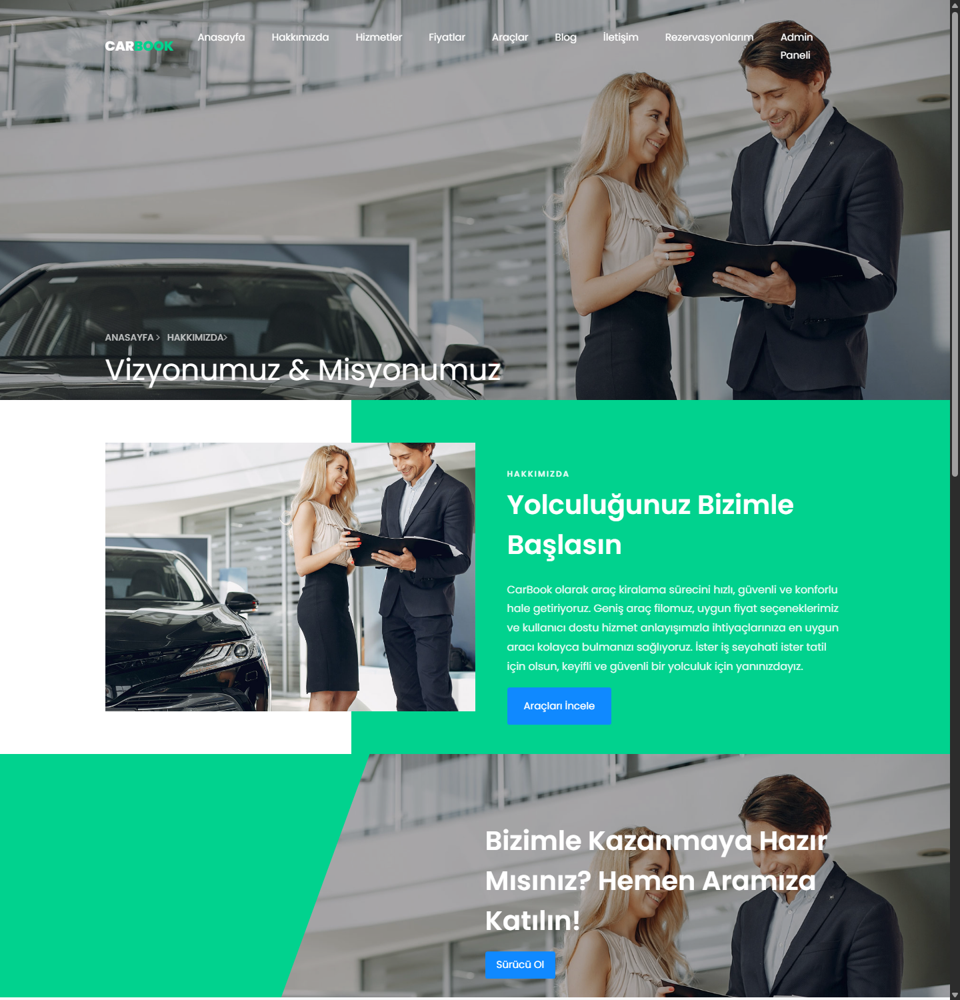
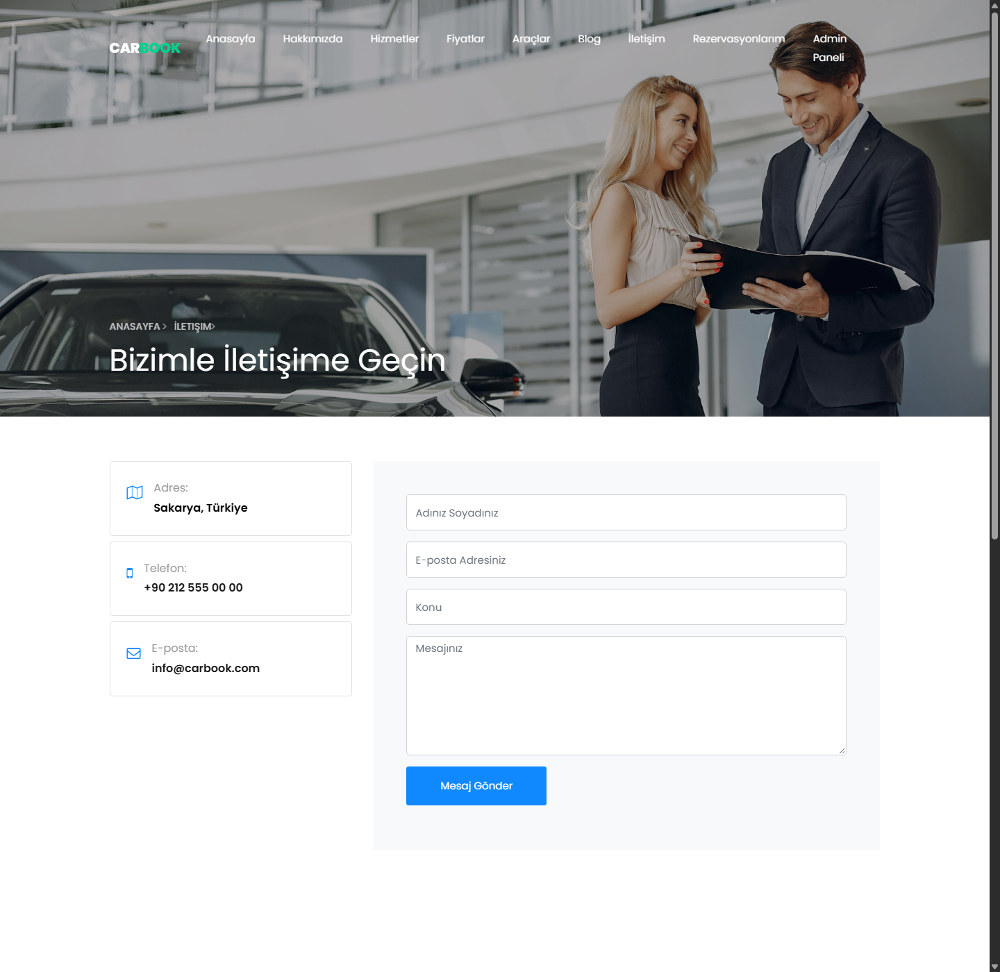

# 🚗 CarBook - Araba Kiralama Web Uygulaması & Admin Paneli


**CarBook**, modern kurumsal yazılım mimarilerine uygun olarak geliştirilmiş; kullanıcı tarafında araç kiralama, filtreleme ve inceleme imkanı sunan, yönetim tarafında ise kapsamlı bir **Admin Paneli** barındıran tam teşekküllü bir **Araba Kiralama Projesidir**.

CarBook projesinde **.NET 10**, **Onion Architecture** (Soğan Mimarisi), **CQRS**, **MediatR**, **Repository Pattern**, **JWT** ve **SignalR** gibi modern yazılım prensipleri ve teknolojileri kullanılmıştır.

---

## 🏗️ Proje Mimari Yapısı (Onion Architecture)

Proje, bağımlılıkların içe doğru aktığı ve katmanların birbirinden soyutlandığı **Onion Architecture** temel alınarak 5 ana projeye bölünmüştür:

```text
CarBook/
 ├── 📂 CarBook.Domain           -> Varlıklar (Entities) & Domain Modelleri
 ├── 📂 CarBook.Interfaces       -> Application Katmanı (CQRS Commands/Queries, Handlers, DTO'lar, Interface'ler)
 ├── 📂 CarBook.Persistence      -> DbContext, Entity Framework Core Konfigürasyonları, Repository İmplementasyonları, Migrations
 ├── 📂 CarBook.WebApi           -> RESTful API End-Point'leri & Swagger
 └── 📂 CarBook.WebUI            -> ASP.NET Core MVC Kullanıcı Arayüzü & Admin Paneli
```

---

## 🛠️ Kullanılan Mimari Tasarım Desenleri ve Teknolojiler

- **Core & Backend Framework:** .NET 10 / C#
- **Mimari:** Onion Architecture (Soğan Mimarisi)
- **Design Patterns:**
  - **CQRS Pattern:** Komut (Create/Update/Delete) ve Sorgu (Read) işlemlerinin sorumluluklarının ayrılması.
  - **MediatR Pattern:** Katmanlar arası bağımlılıkları en aza indiren merkezi mesaj / istek yönlendiricisi.
  - **Repository Pattern:** Veri erişim katmanının soyutlanması ve sürdürülebilir veri yönetimi.
- **Güvenlik & Kimlik Doğrulama:** **JWT (JSON Web Token)** ile güvenli API erişimi ve yetkilendirme.
- **Canlı / Anlık İletişim:** **SignalR** ile anlık bildirimler ve canlı veri akışı.
- **ORM & Veritabanı:** **Entity Framework Core**, **MS SQL Server** ve Code-First Migrations.
- **Arayüz (UI):** **ASP.NET Core MVC (WebUI)**, HTML5, CSS3, JavaScript, Bootstrap.
- **API Dokümantasyonu:** **Swagger / Swashbuckle UI**.

---

## 🚀 Öne Çıkan Özellikler

### 👥 Kullanıcı Arayüzü (WebUI)
- 🚘 **Araç Listeleme & Filtreleme:** Marka, lokasyon ve fiyat türlerine göre dinamik araç arama.
- 📋 **Araç Detay Sayfaları:** Araca ait özellikler (`CarFeature`), detaylı açıklamalar (`CarDescription`) ve günlük/haftalık/aylık fiyatlandırmalar (`CarPricing`).
- 🏬 **Hizmetler & Yorumlar:** Müşteri yorumları (`Testimonial`), sunulan hizmetler (`Service`) ve şirket bilgileri.
- ✉️ **İletişim & Lokasyonlar:** Lokasyon bazlı şube bilgileri (`Location`) ve iletişim formu (`Contact`).

### 🛠️ Admin Paneli
- ⚙️ **Dinamik İçerik Yönetimi:** Araçlar, markalar, kategoriler, hizmetler ve müşteri yorumları için tam CRUD desteği.
- 📊 **Dashboard & İstatistikler:** Sistemdeki aktif araçlar, kiralama verileri ve durum istatistikleri.
- 🔔 **SignalR Anlık Bildirimler:** Admin paneline anlık veri düşmesi ve canlı takip.
- 🔐 **JWT Yetkilendirmeli Yönetim:** Rol bazlı ve güvenli admin oturum yönetimi.

---

### Gereksinimler
- [.NET 10.0 SDK](https://dotnet.microsoft.com/download)
- [MS SQL Server](https://www.microsoft.com/sql-server/) veya LocalDB
- [Visual Studio 2022 / Visual Studio Code](https://visualstudio.microsoft.com/)

---

## 📸 Ekran Görüntüleri

### 🌟 Öne Çıkan Özellikler (Rezervasyon & Anlık Bildirimler)

| Dinamik Rezervasyon Onay Modalı | Rezervasyonlarım & Durum Takip |
|:---:|:---:|
|  |  |

| SignalR Anlık Bildirim Akışı |
|:---:|
|  |

---

### 🌐 Kullanıcı Arayüzü (WebUI)

| Anasayfa & Araç Filtreleme Alanı | Geniş Araç Filosu & Kartlar |
|:---:|:---:|
|  |  |

| Fiyat Paketleri & Karşılaştırma | Blog & Sektörel İçerikler |
|:---:|:---:|
|  |  |

| Detaylı Blog Yazısı & Yazar Bilgisi | Hakkımızda Sayfası |
|:---:|:---:|
|  |  |

| İletişim Formu & Lokasyon Bilgileri |
|:---:|
|  |

